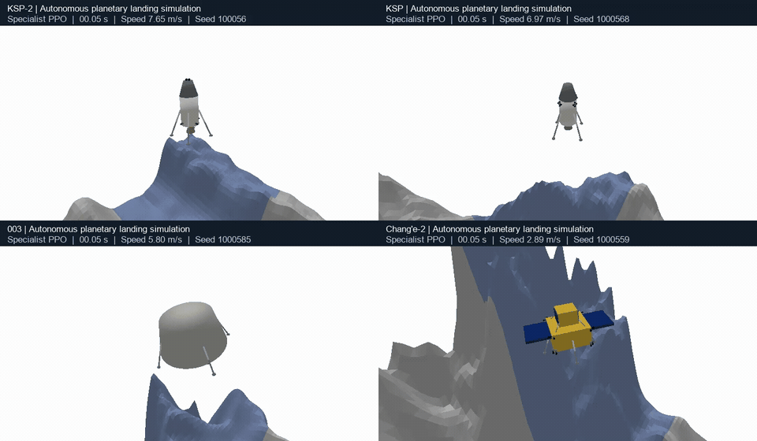
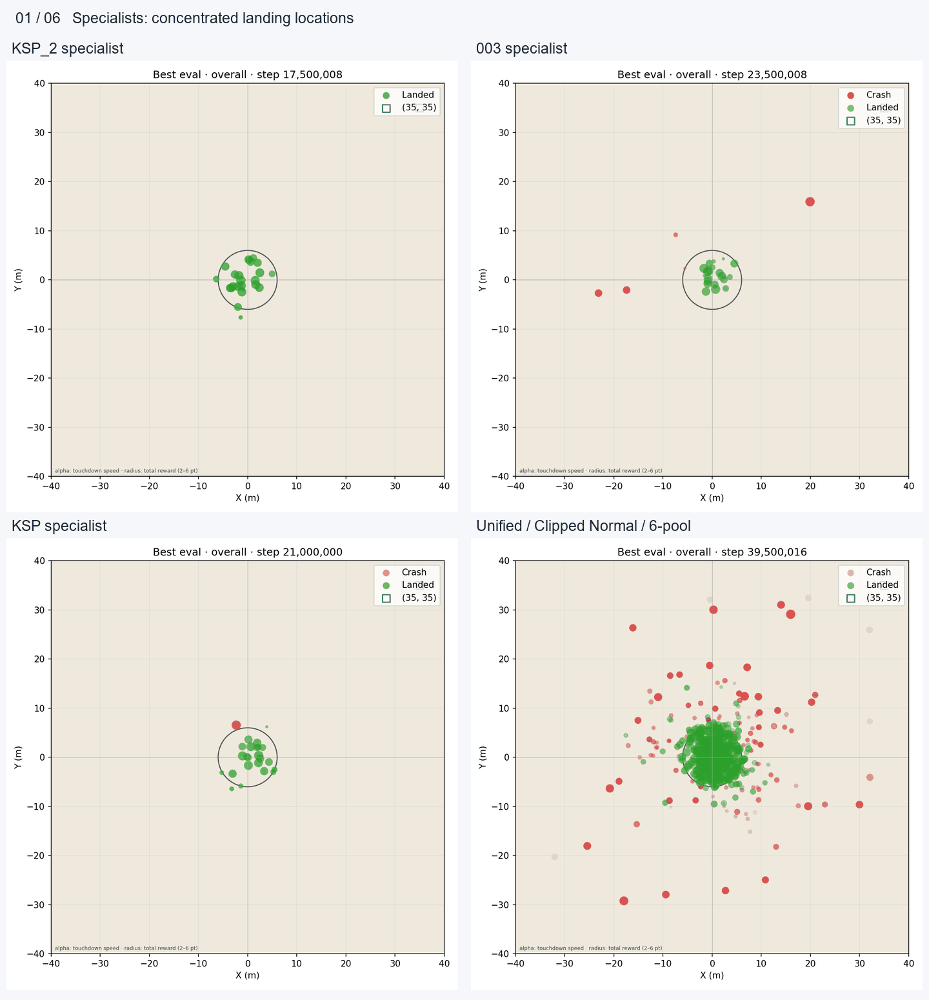
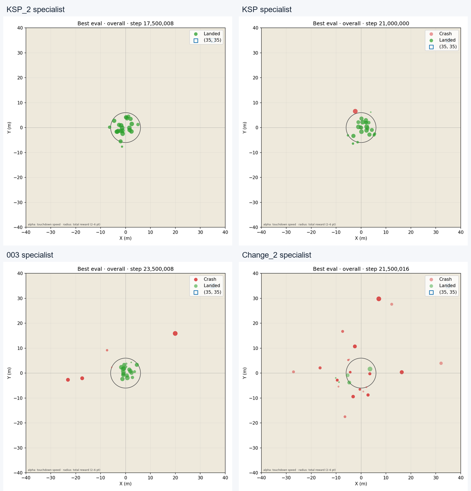

# LunarLander

### Learning to Land Spacecraft with Diverse Configurations

LunarLander is an ongoing research project on reinforcement-learning-based control of planetary landers. I developed a modular 3D lunar-landing simulator, designed spacecraft with different physical properties and engine layouts, and trained controllers to perform autonomous landings.

This repository is a **visual research portfolio** for academic introductions and graduate applications. The research implementation, model weights, training configurations, and detailed experimental records are not included while the work is being prepared for publication.

## Landing demonstrations

*Four selected successful episodes, synchronized at simulation start. Top: KSP_2 and KSP; bottom: 003 and Change_2. Each spacecraft uses its own specialist controller, not one shared policy. Panels freeze when their episodes finish.*

[Watch the full-resolution video](media/specialists_four_panel.mp4) · [Selected experimental evidence](#selected-experimental-evidence)

## Project overview

- **Simulation:** a PyBullet-based 3D lunar-landing environment with processed NASA LRO/LOLA-derived terrain.
- **Spacecraft design:** modular geometric and physical models with different masses, landing legs, engine counts, and thrust layouts.
- **Learning and control:** reinforcement-learning-based throttle control, with ongoing investigation of shared control across different spacecraft.
- **Evaluation:** landing outcomes, touchdown conditions, positional accuracy, and sensitivity to simulated physical variations.

The project spans environment development, spacecraft modeling, controller training, and experimental visualization. Detailed methods and comparative studies remain work in progress.

## Selected experimental evidence

### Landing outcome gallery

*Six four-panel compositions show specialist landings, unified-policy outcomes, failure cases, and a reproducibly random selection of archived maps. Green means landed; red means crashed. The original coordinates, axes, and evaluation-step titles are retained. No points have been removed or repositioned.*

The loop lasts 38 seconds. Favorable/mixed compositions stay visible for 6–8 seconds; failure/random compositions for 4 seconds. **Display duration is an editorial choice, not the frequency of those outcomes.** The slides are selected historical batches with different training steps and sample counts, not a controlled comparison of action distributions or controllers.

Static slides: [1](media/landing_outcomes_grid_01.png) · [2](media/landing_outcomes_grid_02.png) · [3](media/landing_outcomes_grid_03.png) · [4](media/landing_outcomes_grid_04.png) · [5](media/landing_outcomes_grid_05.png) · [6](media/landing_outcomes_grid_06.png).

### Specialist landing locations

*Green points indicate successful landings; red points indicate crashes. Panels show selected historical evaluation batches for KSP_2, KSP, 003, and Change_2 specialist controllers. Original coordinates, axis ranges, and evaluation-step titles are preserved; no points have been removed or repositioned.*

These examples illustrate both concentrated landings and failure cases. They come from different training steps and are **not matched test sets, aggregate success-rate estimates, or a controlled ranking**. Successful demonstration videos likewise do not establish overall reliability or successful transfer between spacecraft.

## Research status

Specialist controllers have produced successful simulated landings for multiple configurations. A major ongoing question is how to obtain stable shared control when spacecraft differ substantially in their dynamics and engine layouts. Broader comparisons and generalization studies are still being developed.

This is a research simulator, **not flight software**. No real-spacecraft validation, flight certification, or publication acceptance is claimed.

## Availability and attribution

This public page intentionally contains only a project overview and selected visual demonstrations. Source code, checkpoints, datasets, detailed learning curves, and experimental configurations are withheld pending publication planning. Their absence is intentional; this is not a runnable software release.

See [NOTICE.md](NOTICE.md) for acknowledgments and usage scope.
